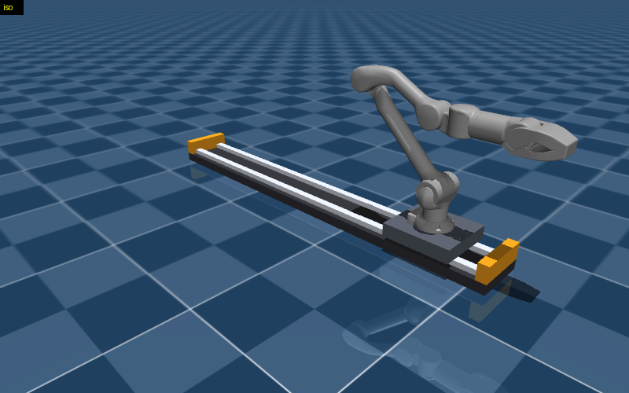

# z1_7axis

A Unitree Z1 arm on a 1 m linear rail (7th axis), simulated in [MuJoCo](https://mujoco.org), plus `mjt`, a small CLI for inspecting, rendering, simulating and debugging MuJoCo models.



## Setup (Linux)

You need [uv](https://docs.astral.sh/uv/) (it installs the right Python for you):

```bash
curl -LsSf https://astral.sh/uv/install.sh | sh
git clone https://github.com/tseluka/z1_7axis
cd z1_7axis
uv sync
```

Open the interactive viewer:

```bash
uv run mjt view models/z1_7axis/scene_gripper.xml
```

- **Space** pauses and resumes. **Backspace** resets to the first keyframe.
- Double-click a body, then **Ctrl + right-drag** to push it around.
- Saving any `.xml` in the model folder reloads it live.

## Models

| path | what |
|---|---|
| `models/z1/` | Unmodified [MuJoCo Menagerie](https://github.com/google-deepmind/mujoco_menagerie) `unitree_z1` (BSD-3, see its `LICENSE`). |
| `models/z1_7axis/z1_7axis.xml` | Z1 on the rail, arm only (7 joints). |
| `models/z1_7axis/z1_7axis_gripper.xml` | Z1 on the rail with gripper (8 joints). |
| `models/z1_7axis/scene*.xml` | The above plus floor and lights. Open these in the viewer. |

**The rail:**
- `joint_rail` is a slide joint along world x with ±0.5 m of travel. It's `qpos[0]`, in meters.
- `motor_rail` is a position servo: its ctrl is the carriage position in meters (kp=2000, kv=400, ±200 N).
- Arm joints `joint1`–`joint6` and `jointGripper` are unchanged from Menagerie.
- Keyframes: `home`, `rail_left`, `rail_right`.

The rail parameters (mass, friction, motor strength) are design guesses, not measured hardware.

## `mjt` commands

Run `uv run mjt <command> --help` for all options. Commands that make images save PNGs to `out/`.

| command | what it does |
|---|---|
| `inspect M` | Bodies, joints, actuators, sensors and keyframes. Shows compile errors verbatim. |
| `tree M -k home` | Kinematic chain with world-frame joint positions and axes. |
| `render S -k home --views iso,front,left,top` | Multi-view PNG. Overlays: `--frames body`, `--collision`, `--contacts`, `--joints`, `--com`. |
| `sim S -k home --hold --t 3` | Run the physics. Prints stability, penetration, limit hits and tracking error, and logs `out/sim.csv`. `--filmstrip 8` saves frames. |
| `check S` | Lint: mass and inertia, unactuated joints, self-collisions, gravity load vs. motor limits, a stability test. |
| `fk M -k home` / `ik M 1.0,0,0.3` | Forward kinematics / damped-least-squares IK. |
| `diff A B` | Compare two models. |
| `view S` / `pose -q joint_rail=0.4` | Interactive viewer, and a command channel to drive it from the terminal. |

Poses can be given as `-k KEYFRAME`, `-q 'joint2=0.5,joint_rail=-0.3'`, or `-q live` (whatever the open viewer is showing).

Examples:

```bash
uv run mjt sim models/z1_7axis/scene.xml -k rail_left --ctrl motor_rail=0.5 --t 3 --filmstrip 8
uv run mjt ik  models/z1_7axis/z1_7axis.xml 1.0,0,0.3 -k home   # reaches it by sliding the rail
```

## Rendering notes

Headless rendering uses EGL by default, which needs working GPU drivers. If rendering fails, try `MUJOCO_GL=osmesa uv run mjt render ...` (needs Mesa's OSMesa).

## License

MIT (see `LICENSE`) for this project's own code and models. `models/z1/` is Unitree's Z1 model from MuJoCo Menagerie under its own BSD-3 license (`models/z1/LICENSE`).
